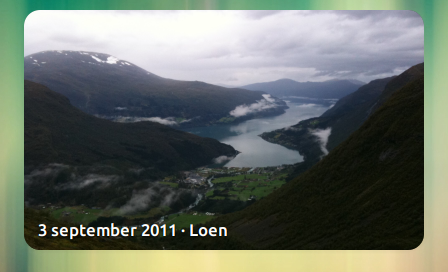
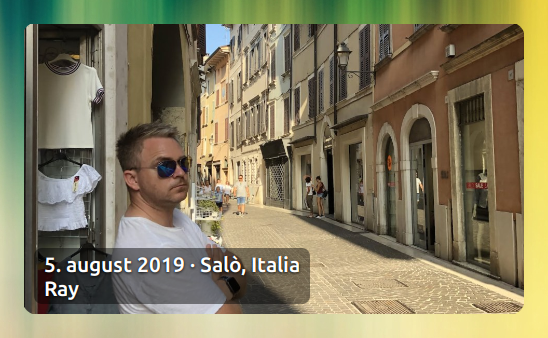
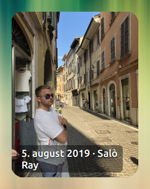
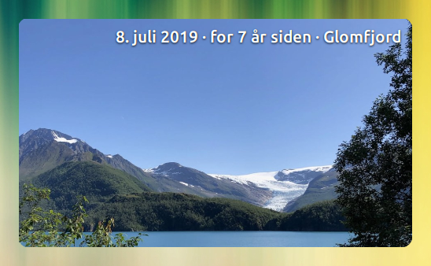
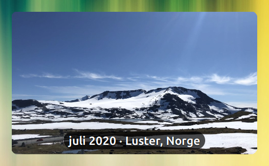
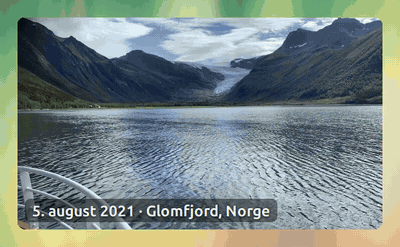
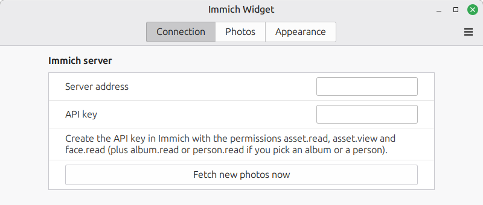

# Immich Widget for Linux Mint / Cinnamon

A desktop photo slideshow for the Cinnamon desktop that shows photos from your own
[Immich](https://immich.app) server.



- **Smart cropping.** Uses Immich face detection to crop each photo to the widget's shape around the people in it, so heads are not cut off.
- **Your photos, your choice.** Tick the people, albums and tags to show, or use *On this day*, favorites, a star rating, a time span, places or Immich smart search ("beach", "snow").
- **Camera photos only.** Screenshots and saved images are skipped (optional).
- **Transitions.** Fade, slide in four directions, zoom and flip – tick several and the widget changes between them. Optional slow Ken Burns zoom towards the faces.
- **Caption you control.** Date, "5 years ago", place, the names of the people and the Immich description, each on or off, in any corner, with an optional rounded background.
- **Works offline.** Photos are cached, and a new batch is fetched on a schedule you choose.
- **Everything is set in the widget's settings.** No config files, no terminal. The settings even tell you which API key permissions your choices need.

Left-click shows the next photo, middle-click opens it in Immich. Right-click to mark it as a favorite or
to never show it again. The slideshow pauses while the mouse is over it.

## Examples

The screenshots are from a Norwegian desktop, so dates and country names are in Norwegian.

| | Settings |
| --- | --- |
|  | **Slow zoom (Ken Burns)** on: the photo zooms slowly towards the face while it is shown (played back at double speed here). One person ticked, names on, place *City, country*, background behind the text. 500 × 290 px. |
|  | **People:** one person ticked. **Text:** date (*27. July 2023*), place *City, country*, names of the people, background behind the text (45 %, radius 8), bottom left. 500 × 290 px, corner radius 16. |
|  | Same as above, but 260 × 340 px and corner radius 28, place *City*. **Crop around faces** keeps the person in the frame. |
|  | **Search for:** *mountains and fjord landscape*. **Text:** top right, *How long ago* on, place *City*, text shadow, no background. |
|  | **Text:** bottom centre, date format *July 2023*, place *City, country*, text size 15 pt, background 70 % with radius 20. |
|  | **Transitions:** fade, slide left, right, up and down, zoom and flip, one after the other (*In turn*), 1100 ms. |
|  | **Show text on the photo** off. 600 × 240 px, corner radius 40. |

## Requirements

- Linux Mint or another distribution with the Cinnamon desktop (tested on Linux Mint 22 / Cinnamon 6.6)
- An Immich server, version 3.2 or newer (tested with Immich 3.3), reachable from the computer, at home or over a VPN such as Tailscale

## Install

From Cinnamon (once it is published on Cinnamon Spices): right-click the desktop → **Add Desklets** →
**Download** tab, search for *Immich Widget* and install it.

Manually:

```sh
git clone https://github.com/RayBomb87/immich-linux-cinnamon-widget.git
cp -r immich-linux-cinnamon-widget/arbeidsfiler/immich-widget@raybomb87 ~/.local/share/cinnamon/desklets/
```

Then right-click the desktop → **Add Desklets**, select **Immich Widget** and click **+**.

## Set up

1. Right-click the widget → **Configure** and enter the server address (for example `http://192.168.1.10:2283`).
2. Make your choices on the **Photos**, **Text** and **Appearance** pages.
3. On the **Connection** page, *Permissions the key needs* now lists exactly the permissions your choices need.
   Click **Open API keys in Immich**, create a new API key with just those permissions and paste it into **API key**.

| Permission | Needed when |
| --- | --- |
| `asset.read`, `asset.view` | Always |
| `face.read` | Crop around faces, Ken Burns zoom or names in the caption |
| `person.read` / `album.read` / `tag.read` | Fetching the lists of people / albums / tags, or showing ticked ones |
| `asset.statistics` | Optional: the number of photos of each person and tag in the lists |
| `memory.read` | *On this day* |
| `asset.update` | Only for *Mark as favorite* in the right-click menu |

If you later turn on something that needs another permission, the widget says which one is missing.



## Settings

| Page | Settings |
| --- | --- |
| Connection | Server address, API key, *Fetch new photos now*, permissions the key needs, *Open API keys in Immich* |
| Photos | People, albums and tags (fetched from Immich, tick to show); on this day; favorites only; at least N stars; taken any time / last 12 months / last 5 years / between two years; places; smart search; screenshots; photos per batch, how often to fetch, time per photo |
| Text | Show text; date and its format; how long ago; place (city / city, country / country); names; description; position; size; shadow; background with opacity and corner radius |
| Appearance | Width × height, corner radius, crop around faces, Ken Burns zoom, transitions (fade, slide left/right/up/down, zoom, flip), random or in turn, duration |

Ticked people, albums or tags mean *any of them*; all the other filters must all match.
You can add several widgets, for example one with favorites and one with a single album.
Each one has its own settings.

## Privacy

- The widget only talks to the Immich server you enter.
- Photos are cached in `~/.cache/immich-widget@raybomb87/<widget id>/`.
- The API key is stored in the widget's settings in your home folder.
  Give the key only the permissions the settings list.
- *Don't show this photo again* is remembered by the widget only; nothing changes in Immich.

## How it works

Everything runs inside the desklet, asynchronously, with Cinnamon's own libraries (libsoup and GdkPixbuf).
At start-up, on a schedule and when the settings change, it asks Immich for photos – `/api/search/random`
(or `/api/search/smart` with a search text, or `/api/memories` for *On this day*) with the search `filter`
introduced in Immich 3.2 – downloads the preview size, crops it around the faces from `/api/faces`
and stores the photos and a `captions.json` in the cache folder. The slideshow plays from that folder.
Rounded corners are drawn with a small GLSL shader on the whole frame, so sliding and zooming photos stay inside them.

## Translations

English and Norwegian Bokmål. Translations are welcome: copy `po/immich-widget@raybomb87.pot`
to `po/<language>.po` and translate it, for example with Poedit.

## License

The example photo in the screenshot is [Loen fra Skåla](https://commons.wikimedia.org/wiki/File:Loen_fra_Sk%C3%A5la.jpg) (CC0).


[MIT](LICENSE)
